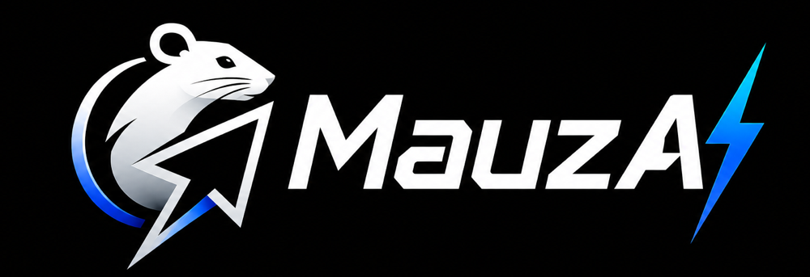

<p align="center">
  
</p>

# Mauz

Mauz is an AI assistant that lives at your mouse cursor. Shake the mouse (or press the shortcut), pick what you want, and Mauz answers about whatever you are looking at, then gets out of the way.

This is a research preview experimenting with ways to make AI feel more accessible, simple, and customizable on the desktop. It is not a finished product: it is a working preview for trying out interaction patterns and for inviting others to build on the idea. Clone it, run it, and make it your own.

Mauz runs on **macOS** and **Windows**.

## Quick start

Requirements: Git, Node.js 22+, pnpm (`corepack enable`), and either a signed-in [Claude Code](https://docs.claude.com/en/docs/claude-code) / [Codex](https://github.com/openai/codex) CLI or an Anthropic / OpenAI API key.

**Windows**

```powershell
git clone https://github.com/NeelM0906/Mauz.git
cd Mauz
.\install-windows.cmd
```

This builds Mauz, adds a **MauzAI** Start menu shortcut, and launches it. Look for the tray icon.

**macOS**

```bash
git clone https://github.com/NeelM0906/Mauz.git
cd Mauz
./install-macos.sh
```

This installs `~/Applications/MauzAI.app` and launches it. Then grant the permissions described in [setup.md](setup.md#macos-permissions).

Full instructions, environment variables, and development mode are in [setup.md](setup.md).

## How it works

1. Shake the mouse or press **Ctrl+Shift+M** (**Cmd+Shift+M** on macOS). A radial menu opens at your cursor.
2. Choose an action:
   - **Ask** — type a question about what is under your cursor.
   - **Explain**, **Transform**, **Remember**, **Compare** — one-click actions on the selected text or the area around the cursor.
   - **Talk** — hold **Space**, speak, release. Mauz answers out loud.
   - **Work on this** — hand a longer task to a supervised agent (optional, see below).
3. Mauz captures only the context that action needs, answers, and you go back to work.

## Bring your own AI

Mauz does not ship with, or require, its own AI account. It answers with the provider you have set up:

| Source                       | How Mauz uses it            | Default model     |
| ---------------------------- | --------------------------- | ----------------- |
| Anthropic API key            | Anthropic API               | `claude-opus-5-5` |
| OpenAI API key               | OpenAI API                  | `gpt-5.4-mini`    |
| Claude Code subscription     | Your signed-in `claude` CLI | `sonnet`          |
| Codex (ChatGPT) subscription | Your signed-in `codex` CLI  | Codex default     |

If only one provider is set up, Mauz uses it. If several are, choose a **default** and an optional **fallback** in **Settings → AI provider**. The fallback answers when the default is not ready or fails. Settings also shows which providers Mauz detected. Subscription CLIs run with tools, hooks, MCP servers, and session history turned off: Mauz only asks them for a text answer.

See [setup.md](setup.md#ai-providers) for details and overrides.

## Talk

Talk is push to talk: hold Space, speak, release. Mauz transcribes your clip, answers with a fresh screenshot of your screen, and reads the answer aloud sentence by sentence. Press Space while it is speaking to interrupt it.

- Transcription uses OpenAI when you have an OpenAI key, otherwise Windows' built-in offline speech recognition.
- Speech uses your system voices.
- The older always-on OpenAI Realtime voice is still available under **Settings → Talk uses**.

See [setup.md](setup.md#talk-push-to-talk).

## Answers and supervised work

- **Simple** (default): direct answers about what you are looking at. No gateway is required.
- **Work on this**: an explicit, supervised task flow for longer work. Mauz captures the context you approve, asks for the outcome you want, checks that the configured gateway supports supervised runs, and shows activity, approvals, and Stop while the task runs.

To enable **Work on this**, select **Agentic** under Settings → Mode and configure a compatible [Hermes](https://github.com/NousResearch/hermes-agent) gateway. See [setup.md](setup.md#agent-gateway-and-work-on-this).

## Context sharing

Mauz is built around user-controlled context sharing.

- Mouse shake only opens the menu. Nothing is captured until you pick an action.
- Cursor crops, screenshots, selected text, and microphone audio are used only for the action you started.
- Talk records only while you hold Space.
- Screen sharing sends explicit screenshot frames only while sharing is active.
- Previous chats store the typed question, Mauz's text answer, a title, and timestamps. Voice turns are not saved.
- On Windows, Mauz's own windows are excluded from screenshots and screen shares. Set `MAUZ_EXCLUDE_FROM_CAPTURE=false` if you want to show Mauz in a demo or recording.

## Platform notes

**Windows**

- Mouse shake works without any special permission.
- Selected text is read through Windows UI Automation, so it works in most native apps and browsers but not every app.
- Mauz runs from the tray: right-click the icon to open it, pause shake, or quit.
- **Ctrl+Shift+M** is also Microsoft Teams' mute shortcut; turn off Mauz's shortcut in Settings if you rely on it in Teams.

**macOS**

- Mouse shake and selected text need Accessibility and Input Monitoring permissions; screenshots need Screen Recording.
- Talk without an OpenAI key is not supported yet (there is no offline transcription on macOS yet).

## Roadmap

- Pointing: Mauz shows you where to click on screen.
- Offline transcription on macOS.
- Lightweight local models for simpler, lower-latency, more private answers.
- Signed builds and a smoother first-run onboarding flow.
- Richer conversation history and context controls.

Contributions are welcome. We hope people build integrations and customize Mauz to their own liking.

## License

MauzAI is available under the [FirstPoint Labs Research Preview License](LICENSE.md). It may be used, modified, and productionized with required attribution to FirstPoint Labs and relevant previous authors, and may never be used for privacy invasion or surveillance.
