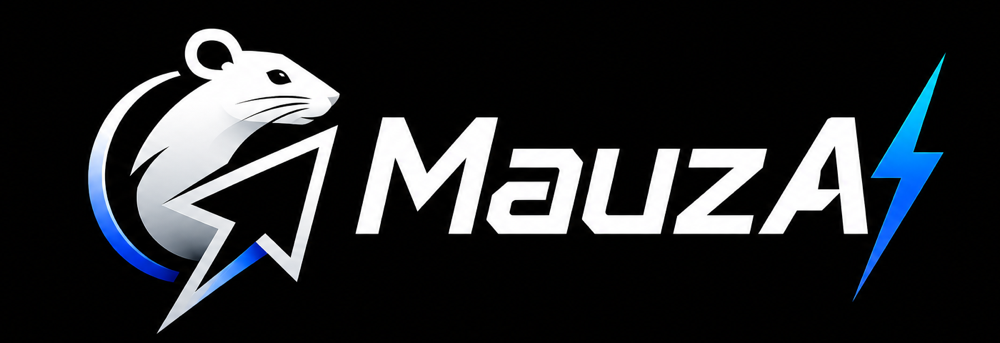

<p align="center">
  
</p>

# Mauz

Mauz is an AI assistant that lives at your mouse cursor. Shake the mouse (or press the shortcut), pick what you want, and Mauz answers about whatever you are looking at, then gets out of the way.

This is a research preview experimenting with ways to make AI feel more accessible, simple, and customizable on the desktop. It is not a finished product: it is a working preview for trying out interaction patterns and for inviting others to build on the idea. Clone it, run it, and make it your own.

Mauz runs on **macOS** and **Windows**.

## Quick start

Requirements: Git, Node.js 22+, pnpm (`corepack enable`), and a Claude or ChatGPT subscription, or an Anthropic or OpenAI API key. You connect them from Mauz's Settings.

**Windows**

```powershell
git clone https://github.com/NeelM0906/Mauz.git
cd Mauz
.\install-windows.cmd
```

This builds Mauz, adds a **MauzAI** Start menu shortcut, and launches it. Look for the tray icon.

**macOS**

```bash
git clone https://github.com/NeelM0906/Mauz.git
cd Mauz
./install-macos.sh
```

This installs `~/Applications/MauzAI.app` and launches it. Then grant the permissions described in [setup.md](setup.md#macos-permissions).

Full instructions, environment variables, and development mode are in [setup.md](setup.md).

## How it works

1. Shake the mouse or press **Ctrl+Shift+M** (**Cmd+Shift+M** on macOS). A dial opens at your cursor.
2. Choose an action:
   - **Ask** — ask about what is under your cursor or selected. Press Ask with nothing typed to learn what it is. Ask a follow-up in the same panel to keep the conversation going.
   - **Send to agent** — hand a task, with what you are pointing at, to your coding agent (Hermes, Claude Code, or Codex).
   - **Dictate** — speak instead of typing, then send the text to Ask or to your agent.
3. Click the Mauz logo in the middle of the dial to open Settings.

## Bring your own AI

Mauz does not ship with, or require, its own AI account. It answers with the provider you have set up:

| Source                       | How Mauz uses it | Default model     |
| ---------------------------- | ---------------- | ----------------- |
| Anthropic API key            | Anthropic API    | `claude-opus-5-5` |
| OpenAI API key               | OpenAI API       | `gpt-5.4-mini`    |
| Claude Code subscription     | The `claude` CLI | `sonnet`          |
| Codex (ChatGPT) subscription | The `codex` CLI  | Codex default     |

To use a subscription, click **Connect** next to it in **Settings → General AI**. Mauz installs the CLI if it is missing and opens the sign-in page in your browser. If the CLI is already signed in on your computer, Mauz picks it up automatically.

If only one provider is set up, Mauz uses it. If several are, choose the **default** in **Settings → General AI**. Subscription CLIs run with tools, hooks, MCP servers, and session history turned off: Mauz only asks them for a text answer. See [setup.md](setup.md#ai-providers) for overrides.

## Send to agent

Send to agent hands your task and what you were pointing at to Hermes, Claude Code, or Codex. Mauz opens the desktop app when it is installed and runs the CLI in the background when it is absent. Codex and Hermes open a new session. Claude Desktop opens a prefilled Code composer for you to review and send. Pick the agent under **Settings → Task agent**. [Setup and permissions](setup.md#send-to-agent)

## Dictate

Dictate starts listening as soon as you choose it. Press Stop or Space when you are done, edit the text if you like, then send it to **Ask** or **Send to agent**. Transcription uses OpenAI when you have an OpenAI key, otherwise Windows' built-in offline speech recognition. See [setup.md](setup.md#dictate).

## Context sharing

Mauz is built around user-controlled context sharing.

- Mouse shake only opens the menu. Nothing is captured until you pick an action.
- Cursor crops, screenshots, selected text, and microphone audio are used only for the action you started.
- Dictate records only until you press Stop.
- Send to agent writes the brief, the screenshot, and the agent's start-up log to a temporary folder; Mauz deletes them after a day.
- On Windows, Mauz's own windows are excluded from screenshots and screen shares. Set `MAUZ_EXCLUDE_FROM_CAPTURE=false` if you want to show Mauz in a demo or recording.

## Platform notes

- **Windows:** shake needs no permission. Mauz runs from the tray, where you can open it, pause shake, or quit. **Ctrl+Shift+M** is also Microsoft Teams' mute shortcut; turn off Mauz's shortcut in Settings if you rely on it there.
- **macOS:** shake and selected text need Accessibility permission, screenshots need Screen Recording, and Dictate needs Microphone. Dictate without an OpenAI key is not available yet. See [setup.md](setup.md#macos-permissions).

### Ask follow-ups

Click away to read or scroll, then summon Mauz again on the same browser page within five minutes to continue Ask. Point at a new passage or visual when invoking Mauz to bring it into the next question. The composer shows which source will be sent. Choose **New chat** to start over or **Back** to return to the dial. Automatic resume requires the Mauz browser extension. Reload the unpacked extension and the page after an update.

## Roadmap

- Pointing: Mauz shows you where to click on screen.
- Offline transcription on macOS.
- Lightweight local models for simpler, lower-latency, more private answers.
- Signed builds and a smoother first-run onboarding flow.

Contributions are welcome. We hope people build integrations and customize Mauz to their own liking.

## License

MauzAI is available under the [FirstPoint Labs Research Preview License](LICENSE.md). It may be used, modified, and productionized with required attribution to FirstPoint Labs and relevant previous authors, and may never be used for privacy invasion or surveillance.
